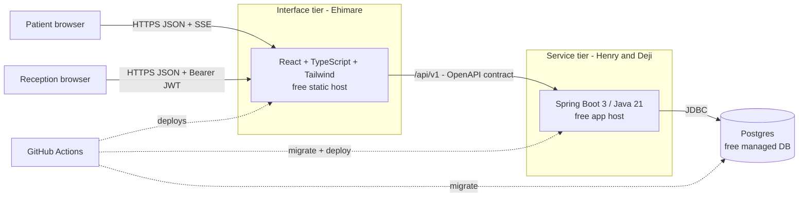
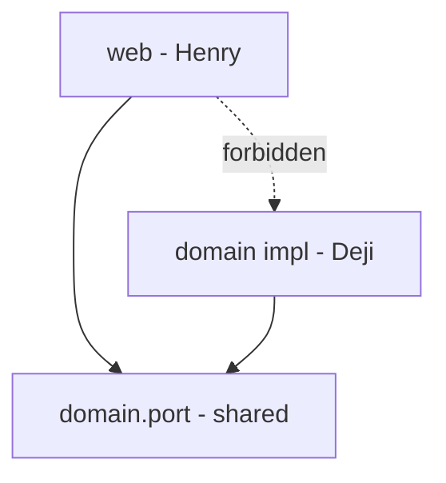
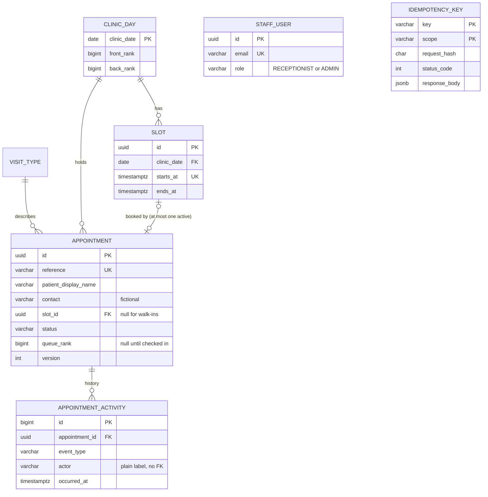
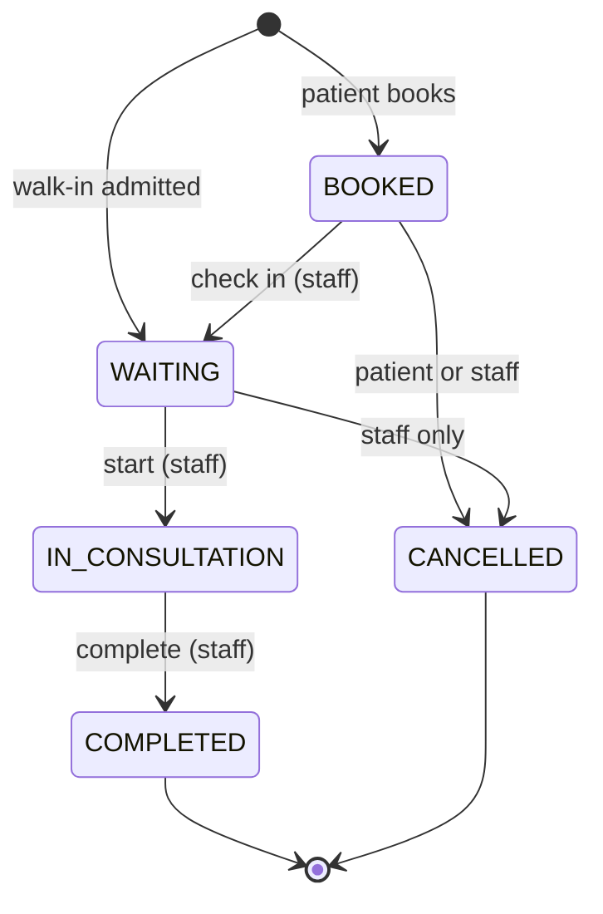
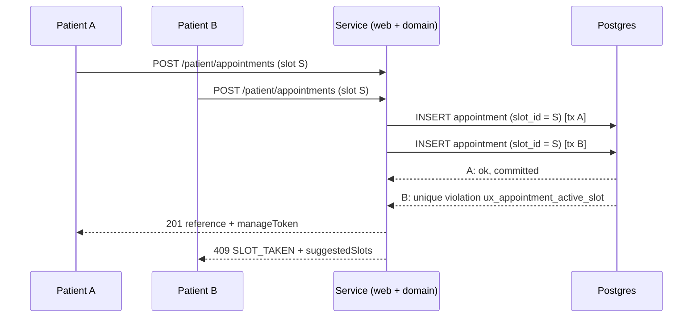
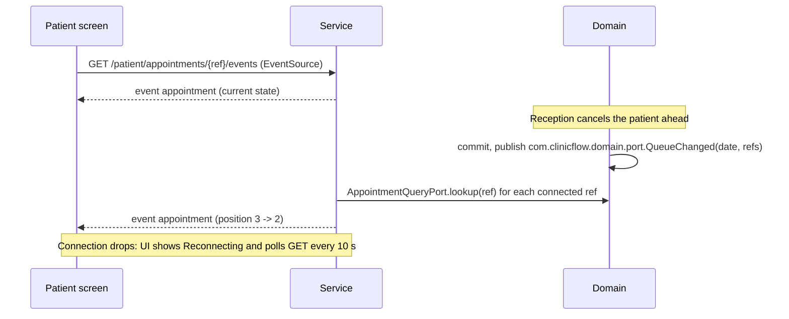
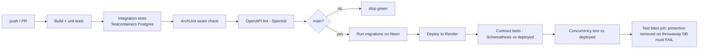

# ClinicFlow: design

How the system is built and why. Read `intent.md` first for what and why-for-whom. Diagrams are Mermaid (GitHub renders them).

**Owners:** service design Henry + Deji · interface notes Ehimare · status: v0.1, 22 Oct 2026

---

## 1. System at a glance



- The interface **never** talks to the database. It only knows the contract.
- One clinic, one currency of data (appointments), no clinical data, no integrations.

### Chosen stack (confirm hosts against each provider's own pricing page and record the date, as the brief requires)

| Piece | Choice | Why |
|---|---|---|
| Service | Spring Boot (Java 21, Maven) | Team already works in it. Strong Postgres and transaction support. |
| DB | Postgres (free managed) | Partial unique indexes and row locks are what protect the rules. |
| Migrations | Flyway, forward scripts + hand-written down scripts | Free tier of Flyway has no undo; see ADR-004 |
| Service host / DB host | Render web service / Neon (used on PayBridge) | Free, familiar. **Verify current terms**: idle sleep, hour allowances, DB expiry, project pauses. |
| Interface | React + TS + Tailwind, React Router | Ehimare's call. Static host free tier. |
| Mock | Prism (from the YAML) | Generated from the contract, one command. |
| Contract tests | Schemathesis against the deployed URL | Fails the build when the service drifts from the YAML. |
| Load test | k6 | Reports p50/p95/p99, scriptable stages. |

---

## 2. Code structure and the dependency rule

```
com.clinicflow
├─ web/            HENRY   controllers, dto, security, error mapping, idempotency, sse
├─ domain/
│   ├─ port/       SHARED  interfaces, records, exceptions, events  <- the seam
│   └─ ...         DELI    implementations, repositories, rules, seed
└─ ClinicFlowApplication
```



ArchUnit test (Henry owns it, runs on every push):

```java
import static com.tngtech.archunit.base.DescribedPredicate.not;
import static com.tngtech.archunit.core.domain.JavaClass.Predicates.resideInAPackage;

@ArchTest
static final ArchRule web_only_sees_ports =
    noClasses().that().resideInAPackage("com.clinicflow.web..")
        .should().dependOnClassesThat(
            resideInAPackage("com.clinicflow.domain..")
                .and(not(resideInAPackage("com.clinicflow.domain.port.."))));
```

Spring profile `clinicflow.ports=fake|real` chooses between in-memory fakes (Henry) and real implementations (Deji).

---

## 3. Roles and access

Patients are **anonymous**; they hold a reference (and a manage token for changes). Staff log in.

| Capability | Anonymous patient | RECEPTIONIST | ADMIN |
|---|---|---|---|
| List visit types, list slots | ✔ | ✔ | ✔ |
| Book a slot | ✔ (rate limited) | n/a | n/a |
| View **own** booking + position, live stream | ✔ (by reference) | n/a | n/a |
| Cancel / reschedule own booking while `BOOKED` | ✔ (manage token) | n/a | n/a |
| List/search all appointments, detail, activity | ✘ | ✔ | ✔ |
| Check in, start, complete, cancel, reschedule (staff) | ✘ | ✔ | ✔ |
| Admit walk-in | ✘ | ✔ | ✔ |
| Queue view, dashboard, recent activity | ✘ | ✔ | ✔ |
| `POST /demo/reset` | ✘ | ✘ | ✔ |

**Enforced in the service** (Spring Security method rules + the port layer ignores nothing). The mandatory authorisation test: a RECEPTIONIST token calls `POST /demo/reset` directly and must get 403; the test must fail when the `@PreAuthorize("hasRole('ADMIN')")` is removed. A second assertion: anonymous call to `PUT /appointments/{id}/status` returns 401.

**Patient privacy.** `com.clinicflow.domain.port.PatientView` has no `contact` field and no other patient's data by construction. A test serialises a `PatientAppointment` and asserts the JSON contains no seeded contact string and no other seeded patient name.

**Reference and tokens.** Reference `CF-XXXX-XXXX`, 8 chars from Crockford base32 (~40 bits), random, unique-indexed. Manage token: 22 random URL-safe chars, shown once, only its SHA-256 stored. Public lookup endpoints are rate limited (stops guessing).

**Staff auth.** `POST /auth/login` → short-lived JWT (e.g. 60 min), BCrypt passwords. No refresh in the MVP; the interface treats any `401` as "sign in again". Demo credentials go in the README and are labelled demonstration only.

---

## 4. The seam: ports Henry and Deji agree on tonight

Package `com.clinicflow.domain.port`. Everything is plain Java records and interfaces so Henry's fakes and Deji's real code are interchangeable.

```java
public enum Status { BOOKED, WAITING, IN_CONSULTATION, COMPLETED, CANCELLED }
public enum ActorRole { PATIENT, RECEPTIONIST, ADMIN, SYSTEM }
public record com.clinicflow.domain.port.Actor(String label, ActorRole role, String requestId) {}   // Henry builds it from the JWT / request

// ---------- commands (Henry -> Deji)
public record com.clinicflow.domain.port.BookCommand(String patientName, String contact, String visitTypeCode, UUID slotId, com.clinicflow.domain.port.Actor actor) {}
public record com.clinicflow.domain.port.WalkInCommand(String patientName, String contact, String visitTypeCode, boolean aheadOfQueue, com.clinicflow.domain.port.Actor actor) {}
public record com.clinicflow.domain.port.AppointmentFilter(LocalDate date, Set<Status> statuses, String q, int page, int size) {}

// ---------- views (Deji -> Henry; Henry maps to DTOs, never exposes entities)
public record com.clinicflow.domain.port.VisitTypeView(int id, String code, String label, int durationMinutes) {}
public record com.clinicflow.domain.port.SlotView(UUID id, Instant startsAt, Instant endsAt, boolean available) {}
public record com.clinicflow.domain.port.EstimateView(int minutes, String basis) {}
public record com.clinicflow.domain.port.PatientView(String reference, String patientName, com.clinicflow.domain.port.VisitTypeView visitType, Instant slotStart, Instant slotEnd,
                          Status status, Integer queuePosition, Integer peopleAhead, com.clinicflow.domain.port.EstimateView estimate,
                          boolean canCancel, boolean canReschedule, Instant updatedAt) {}
public record com.clinicflow.domain.port.StaffView(UUID id, String reference, String patientName, String contact, com.clinicflow.domain.port.VisitTypeView visitType,
                        Instant slotStart, Instant slotEnd, boolean walkIn, Status status, Integer queuePosition,
                        Instant checkedInAt, Instant consultationStartedAt, Instant completedAt, Instant cancelledAt,
                        String cancelReason, int version, Instant createdAt, Instant updatedAt) {}
public record com.clinicflow.domain.port.BookingResult(com.clinicflow.domain.port.PatientView appointment, String manageToken) {}
public record com.clinicflow.domain.port.QueueSnapshot(LocalDate date, List<com.clinicflow.domain.port.StaffView> inConsultation, List<com.clinicflow.domain.port.StaffView> waiting, Instant generatedAt) {}
public record com.clinicflow.domain.port.DashboardView(LocalDate date, int total, int booked, int waiting, int inConsultation, int completed,
                            int cancelled, int walkIns, Instant generatedAt) {}
public record com.clinicflow.domain.port.ActivityView(long id, UUID appointmentId, String reference, String eventType, Status from, Status to,
                           String actor, ActorRole actorRole, Instant occurredAt) {}
public record com.clinicflow.domain.port.PageResult<T>(List<T> items, int page, int size, long totalItems) {}

// ---------- ports
public interface SlotPort        { List<com.clinicflow.domain.port.VisitTypeView> visitTypes(); List<com.clinicflow.domain.port.SlotView> slotsFor(LocalDate date); }
public interface BookingPort     {
  com.clinicflow.domain.port.BookingResult book(com.clinicflow.domain.port.BookCommand c);
  com.clinicflow.domain.port.PatientView   cancelByPatient(String reference, String manageToken, String reason);
  com.clinicflow.domain.port.PatientView   rescheduleByPatient(String reference, String manageToken, UUID newSlotId);
  com.clinicflow.domain.port.StaffView     rescheduleByStaff(UUID id, UUID newSlotId, com.clinicflow.domain.port.Actor actor);
}
public interface QueuePort       {
  com.clinicflow.domain.port.StaffView     changeStatus(UUID id, Status expected, Status target, String reason, com.clinicflow.domain.port.Actor actor);
  com.clinicflow.domain.port.StaffView     admitWalkIn(com.clinicflow.domain.port.WalkInCommand c);
  com.clinicflow.domain.port.QueueSnapshot queue(LocalDate date);
}
public interface AppointmentQueryPort {
  com.clinicflow.domain.port.PageResult<com.clinicflow.domain.port.StaffView> search(com.clinicflow.domain.port.AppointmentFilter f);
  com.clinicflow.domain.port.StaffView get(UUID id);
  com.clinicflow.domain.port.PatientView lookup(String reference);                 // derived position + estimate
  List<com.clinicflow.domain.port.ActivityView> activity(UUID id);
  List<com.clinicflow.domain.port.ActivityView> recent(int limit);
}
public interface DashboardPort   { com.clinicflow.domain.port.DashboardView dashboard(LocalDate date); }
public interface DemoPort        { void resetDay(LocalDate date); }

// ---------- event (Deji publishes AFTER COMMIT; Henry's SSE broadcaster listens)
public record com.clinicflow.domain.port.QueueChanged(LocalDate clinicDate, Set<String> references) {}
```

### Domain exceptions → HTTP (Henry owns this table; Deji only throws)

| Exception (in `domain.port`) | HTTP | `code` | Notes |
|---|---|---|---|
| `SlotTakenException(List<com.clinicflow.domain.port.SlotView> suggestions)` | 409 | `SLOT_TAKEN` | Becomes `suggestedSlots` |
| `SlotInPastException` | 422 | `SLOT_IN_PAST` | |
| `UnknownVisitTypeException`, bean validation failures | 422 | `VALIDATION_FAILED` | `fieldErrors` |
| `InvalidTransitionException(com.clinicflow.domain.port.StaffView current)` | 409 | `INVALID_TRANSITION` | `current` filled |
| `StaleStateException(com.clinicflow.domain.port.StaffView current)` | 409 | `STALE_STATE` | `expectedStatus` didn't match |
| `NotFoundException` | 404 | `NOT_FOUND` | Also for a wrong reference |
| `BadManageTokenException` | 401 | `UNAUTHENTICATED` | |
| `ClinicClosedException` | 409 | `CLINIC_CLOSED` | |
| anything else | 500 | `INTERNAL_ERROR` | Logged with `requestId`; message never leaks internals |

---

## 5. Data model

Full DDL: `db/migration/V1__clinicflow_core.sql` (Deji) and `V100__api_support.sql` (Henry). **Both were applied to a real Postgres and tested** (see §14).



`staff_user` and `idempotency_key` are intentionally **not** linked to Deji's tables, so the two migration streams never block each other.

### Status sequence (documented rule, enforced by Deji's code and a CHECK)



Anything not drawn is `409 INVALID_TRANSITION`.

### Queue position is derived, not stored

- At check-in the appointment gets a `queue_rank`: normal check-in → `clinic_day.back_rank` then `back_rank++`; walk-in ahead of queue → `clinic_day.front_rank` then `front_rank--` (so it can be 0, −1, −2…).
- **Position = 1 + number of WAITING appointments that day with a lower rank.**
- Cancelling or starting someone changes their status, so they stop counting: everyone behind moves up automatically. There is no renumbering `UPDATE` that could go wrong.
- `ux_appointment_queue_rank` makes a duplicate rank impossible even if the code is wrong.

### Wait estimate (always labelled)

`minutes = peopleAhead × avg`, where `avg` = mean of today's completed consultation lengths if ≥ 3 have completed, otherwise the visit type's default `duration_minutes`. `basis` says which: *"About 12 min per person ahead, from today's 7 completed consultations"* or *"…from the default 20 min for a general consultation (too few visits today to average)"*. `estimate` is null unless `status = WAITING`.

### Five most important queries and their indexes (fill in real `EXPLAIN ANALYZE` numbers when the seed exists; this table is the template Deji completes)

| # | Query | Index | Expected examined vs returned | Degrades as table grows? |
|---|---|---|---|---|
| 1 | Slots for a date + which are taken | `ix_slot_day (clinic_date, starts_at)` + `ux_appointment_active_slot` | ~20 slots, ~20 returned | No: bounded by one day |
| 2 | Staff list: date + status filter | `ix_appointment_day_status` | ≈ returned | Only with appointments per day (small) |
| 3 | Queue order for a day | `ix_appointment_waiting` (partial, `status='WAITING'`) | ≈ waiting count | No |
| 4 | Position for one patient (`count` of lower rank) | `ix_appointment_waiting` | ≤ waiting count | No |
| 5 | Lookup by reference | `UNIQUE(reference)` | 1 / 1 | No |
| (dash) | Counts by status for a date | `ix_appointment_day_status` | one day's rows | Bounded per day |
| (feed) | Recent activity | `ix_activity_recent` | `limit` / `limit` | No |

**Index deliberately not created:** a trigram (`pg_trgm`) index on `patient_display_name` for the search box. Search is always scoped to one clinic day (tens to low hundreds of rows), so a sequential scan within the `(clinic_date, status)` range is cheaper than maintaining the index. Reverse the decision if a single day's rows or an all-dates search grows beyond about 50,000 rows.

---

## 6. Concurrency and idempotency: the heart of the grade

### 6.1 Two people book the same slot



- **No read-then-write.** The service does *not* check "is it free?" and then insert. It inserts, and the unique index decides. (A friendly pre-check for validation messages is allowed, but is never relied on for correctness.)
- The losing transaction is rolled back; Deji's code catches the violation of that specific index, queries up to 3 nearest free slots in a **new** transaction, and throws `SlotTakenException(suggestions)`.
- A cancelled booking no longer matches the index's `WHERE`, so the slot is free again. Verified.
- Reschedule: `UPDATE appointment SET slot_id = :new` in one transaction; the unique index rejects it if the new slot was just taken, and the old slot is untouched.

### 6.2 Queue changes serialise per day

Every queue-changing operation (check-in, walk-in, start, complete, cancel of a WAITING patient) begins with:

```sql
SELECT 1 FROM clinic_day WHERE clinic_date = :d FOR UPDATE;
```

then reads the counters and the appointment, validates the transition against `expectedStatus`/`version`, writes, appends an activity row, commits. One clinic means one lock, so contention is tiny and correctness is simple. The unique rank index is the backstop if anyone ever skips the lock.

### 6.3 Same submission twice (network stall)

Henry's idempotency wrapper (web layer) runs the whole request in one transaction:

```
tx begin
  INSERT INTO idempotency_key(key, scope, request_hash) ... ON CONFLICT DO NOTHING
  if inserted:     call the port; UPDATE the row with status_code + response_body; commit
  if not inserted: (Postgres waits until the first transaction commits or aborts)
       same hash   -> return the stored response with the stored status (replay)
       other hash  -> 422 IDEMPOTENCY_KEY_MISMATCH
tx end
```

Because the key and the booking share one transaction, a failed first attempt (e.g. `SLOT_TAKEN`) leaves no key behind, and a retry gets a fresh chance. The client's part: one `Idempotency-Key` per form submission, reused on every retry. Documented in the OpenAPI intro.

### 6.4 Nothing runs in the background

There is no scheduler. Everything time-dependent (past slots hidden, estimates, "slot is in the past") is computed when read. **If a background job didn't run for an hour, nothing would change**, because no job exists. A `BOOKED` patient who never arrives simply stays `BOOKED` until reception cancels them; that is a declared limitation, not a hidden job.

---

## 7. Live position without reloading



- Henry's `SseBroadcaster` keeps `reference → emitters` in memory and listens for `com.clinicflow.domain.port.QueueChanged` **after commit**.
- Single service instance, so in-memory registry is enough (declared limitation: scaling to two instances would need a shared bus; a free host sleeping/restarting drops connections, which the client handles by reconnecting).
- Keep-alive comment every ~25 s so proxies don't close the stream.

---

## 8. Observability

- The interface sends `X-Request-Id` (UUID) on every call. `RequestIdFilter` (Henry) reads it (or generates one), puts it in MDC as `requestId`, and echoes it on the response, including errors (`Problem.requestId`).
- `logback-spring.xml` (Deji) writes JSON logs including `requestId`, `actor`, `event`, `reference` (never contact details).
- Activity rows store `request_id`, so one patient's journey can be followed: browser network tab → response header → log line → activity row.

---

## 9. Delivery



- A red step blocks everything after it. Nothing is deployed by hand.
- **Migration job** runs Flyway before deploy. **Rollback workflow** (`workflow_dispatch`) runs the matching `db/down/Vn__down.sql`. A CI test applies up → down → up on Testcontainers so a broken down script is caught immediately.
- **"Test bites" job:** applies migrations to a throwaway database, drops `ux_appointment_active_slot`, runs the concurrency test, and **asserts it fails**. This gives the brief's "show the test failing with the protection removed" as a repeatable CI result, not a one-off screenshot.
- Secrets live in GitHub/Render environment settings. None in the repo.
- **Free tier checklist (write results and the date in the README):** idle sleep (cold start before the demo: warm it 5 minutes early), monthly hour allowance, database expiry, inactive-project pause, number of free projects per account (ClinicFlow and up-next each need a service + a database: decide one account or several and record it).

---

## 10. Test strategy

Every business rule has a test that **fails when the rule is removed**. Integration tests use a real Postgres (Testcontainers), not H2.

| Rule (from the brief) | Test | Owner | Fails when removed by… |
|---|---|---|---|
| A slot cannot be booked twice, even simultaneously | `SlotBookingConcurrencyIT` (N threads, barrier, assert exactly 1 success) and the deployed-URL version | Deji (logic), Henry (pipeline) | dropping `ux_appointment_active_slot` |
| Status changes follow the sequence | `StatusTransitionTest` (all 25 pairs) | Deji | removing the transition table |
| Cancel mid-queue closes the gap | `CancelRenumbersIT` | Deji | counting cancelled rows in the position query |
| Two simultaneous check-ins → no duplicate position | `ConcurrentCheckInIT` | Deji | dropping the day lock **and** the rank index |
| Walk-in can be admitted ahead of the queue | `WalkInAheadIT` | Deji | assigning back_rank to walk-ins |
| Only staff change queue state | `AuthorizationIT` (anonymous 401, wrong role 403, direct HTTP) | Henry | removing the security rule |
| Patient view never exposes other patients | `PatientViewPrivacyIT` | Henry | adding `contact` to the DTO |
| Estimate is labelled with its basis | `EstimateTest` | Deji | returning minutes without `basis` |
| Same submission twice records once | `IdempotencyIT` (same key twice, concurrently, and sequentially) | Henry | removing the key row |
| Live position updates without reload | `SseIT` | Henry | not publishing `com.clinicflow.domain.port.QueueChanged` |
| Service still satisfies the contract | Schemathesis in pipeline | Henry | any divergence |
| Fictional data only | Seed review checklist (all names and contacts invented, labelled in the UI and README). A policy, not an automated test. | Deji | n/a |

**Wrong-role test, phrased the way the brief wants it:** call the service directly (not via the UI), with the wrong role, assert the refusal, show it failing when the check is deleted.

---

## 11. Seed data (Deji)

A repeatable runner that builds **today's** clinic day in Africa/Lagos, so a clean demo always starts from a believable day. `POST /demo/reset` re-runs it.

| Requirement | Seed |
|---|---|
| ≥ 38 appointments across every status | 40 for the day: 12 COMPLETED, 1 IN_CONSULTATION, 8 WAITING, 16 BOOKED, 3 CANCELLED |
| At least one cancellation | 3: one BOOKED cancelled by patient, one WAITING cancelled mid-queue, one cancelled whose slot was then rebooked |
| One walk-in admitted out of order | 3 walk-ins; one admitted **ahead of the queue** (rank ≤ 0) |
| Awkward cases | One 120-character name · a name with an apostrophe and accents · two patients with the same name · a fully booked slot · a past slot never booked · a closed tomorrow (no slots) · a booking with a contact placeholder only |
| Demo staff | `reception@clinicflow.demo` (RECEPTIONIST) and `admin@clinicflow.demo` (ADMIN), passwords in the README, labelled demonstration only (Henry's seeder) |

All names and contacts are invented. Nothing claims a relationship with a real clinic.

---

## 12. Load test (Deji writes, Henry wires)

- **Target (set it before you test):** p95 ≤ 500 ms and error rate ≤ 1% for `GET /slots`, `POST /patient/appointments`, `GET /queue`, `GET /patient/appointments/{ref}`.
- **Scenarios:** read-heavy browse (70%), booking against a pre-generated pool of load-test slots (20%), reception queue polling (10%).
- **Stages:** ramp 5 → 10 → 25 → 50 → 100 virtual users, 1 minute each. The **saturation point** is the first stage where p95 or error rate misses the target. A report with no saturation point means the test was too gentle, so keep ramping until something breaks (a free instance usually breaks early; that's fine, report it honestly).
- Report p50 / p95 / p99 per endpoint in the README with the date and the host.

---

## 13. Notes for the interface (Ehimare)

- Five states on every screen: **loading, empty, error, success, confirmation**. "Empty" = first use with no data.
- **Optimistic action (state this in the README):** reception's *check-in* button. Row moves to WAITING immediately; on `STALE_STATE`/`INVALID_TRANSITION` replace it with `problem.current` and show a message like "Maria was already checked in by someone else."
- **Never leave a spinner:** on `409 SLOT_TAKEN` show the apology plus `suggestedSlots`. On network drop mid-write show "We couldn't confirm your booking. Check with your reference or try again" and retry with the **same** `Idempotency-Key`.
- **Estimates:** wherever `estimate` appears, show it as an estimate and render `basis` beside it.
- **Staleness:** the staff queue shows `generatedAt` ("Updated 10:42:08") and refreshes itself.
- **Demonstration mode:** banner from `GET /meta` (`demoMode`), plus a labelled "Reset demo day" admin button.
- WCAG 2.2 AA: announce status changes (`aria-live`), visible focus, keyboard operable, labelled inputs; test with NVDA/VoiceOver and record findings in the README.

---

## 14. Evidence so far

Run on 22 Oct 2026 against a real Postgres (bundled via `pgserver`) using `db/verify_schema_concurrency.py`:

| Check | Result |
|---|---|
| `V1` + `V100` apply cleanly | ✔ |
| 8 threads book one slot **with** protection | 1 success, 7 refused |
| Same race **without** protection (index dropped) | 8 successes (the double-booking bug) |
| Cancelled booking frees the slot for a new one | ✔ |
| Two appointments cannot share a queue rank | ✔ |
| Down scripts then up scripts round-trip | ✔ |
| `openapi.yaml` validates as OpenAPI 3.0.3 | ✔ (20 operations, 21 schemas) |

Not yet verified (be honest in the README): the Java code (nothing is written yet), Schemathesis against the YAML, Prism's handling of every example, and all free-tier terms.

---

## 15. Risks

| Risk | Likelihood | Mitigation |
|---|---|---|
| One day behind the brief's path | High | Contract + schema done in parallel tonight; swap fake→real by ports; protect main product, tell Laja Friday if the side project must shrink |
| Interface engineer carries two products | High | Shared component set; side project second; a service engineer takes basic side-project screens if needed (record it) |
| Free host sleeps during the demo | Medium | Warm up 5 min early; have the local run as a fallback |
| SSE dropped by the host | Medium | 10 s polling fallback, visible "Reconnecting" |
| Scope creep (medical fields, SMS, multi-clinic) | Medium | `intent.md` §4 out-of-scope list is the answer |
| Concurrency test passing without the protection | Medium | "Test bites" job makes the failure automatic |
